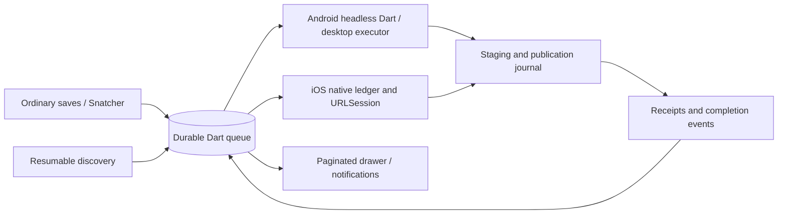

# Background downloads and Snatcher rework

Implementation branch: `downloads-background-rework`. Its base is `settings-rework` (`3a2d16aa`), followed by merges of `develop` (`d4e26098`, merge `68bf063c`) and `enable-ios` (`21c90813`, merge `5bb02009`). Work is isolated in `.worktrees/downloads-background-rework`; the original checkout is preserved.

## Ownership and data flow

Ordinary saves and the existing Snatcher form enqueue durable batches through `SnatchHandler`. Enqueue succeeds only after the SQLite transaction commits. The UI observes summaries and pages; it does not own transfer execution. `ImageWriter` retains cache, sharing and filename responsibilities.

The independent, versioned database in `lib/src/downloads/download_store.dart` contains batches, tasks, discovery checkpoints, selected post identities, current attempts, retry deadlines, publication receipts, completion events, presets and request cooldowns. It is available when favourites/history storage is disabled. Credentials and transport configuration are refreshed separately from the snapshotted destination, output quality and duplicate policy.



Task identity includes source, post/media identity, selected variant and destination. Attempt IDs and task/batch generations fence obsolete work. Expiring URLs and widget identities do not define duplicates. Accepted discovery tasks and their next checkpoint commit together. A failed page never advances the checkpoint or masquerades as source exhaustion.

The amount is the number of eligible distinct posts selected. Existing files count as selected posts and are reported as skipped; they do not cause replacement searching. All media belonging to an accepted multi-file post may produce tasks. Filtering loads tracked values first and preserves the actual source. Cursor, local-source, merged-source and Hydrus adapters have explicit checkpoints. InkBunny uses one post per discovery request because its post responses can expand into multiple media records. Hydrus IDs are streamed to disk and metadata is fetched in bounded pages.

Queue/query pages are capped at 100 records, drawer batch pages at 20, and progress updates at twice per second. Pending payloads remain in SQLite. Dart runs at most three transfers and one discovery operation, subject to the shared three-operation network gate. The 10,000-file target has critical coverage written, but no scale benchmark has been executed.

## Execution and rate admission

**Android:** `DownloadHost` owns one aggregate persisted UIDT job on API 34+, or one direct `dataSync` foreground service on older versions, and one process-wide headless Flutter engine. Adding a batch wakes the same executor. Storage and notifications use application context; `MainActivity` only attaches channels and forwards notification intents. Stop callbacks fence their owner. Abandoned attempts are recovered from disk. A rejected launch or explicit stop appears as a resume requirement. There is no periodic restart loop or WorkManager execution loop; bounded reconciliation occurs when the executor starts or the app reopens.

**iOS:** `DownloadBackend` owns a background URLSession and independent SQLite ledger. Submission intent is persisted before native task creation. Reconciliation matches task descriptions, native IDs, staged files and receipts before resubmission. Delegate temporary files are moved into durable storage before returning. Native publication and notifications do not require Flutter. Dart acknowledges receipts only after applying them transactionally. Already prepared files continue while discovery is suspended. iOS 26 continued processing is opportunistic; registration, denial and expiration preserve foreground resumption. Deployment remains iOS 14.

Dart admission enforces both logical-site and actual-host budgets: three operations globally, one per site, and a delay of at least one second or the stricter source/adapter limit. Discovery, details, URL refresh and media requests use the same download gate. Rate deadlines persist; 429/503 honor both forms of `Retry-After`. Transient errors have five attempts, with exponential delay from five seconds to five minutes and bounded jitter. Network/OS waits do not consume attempts. Retries are scoped to downloads, never installed on general requests or server-favourite mutations.

iOS uses **one outstanding native transfer globally**, with completion-based cooldown, and foreground discovery consults native admission. This is deliberately more conservative than the three-operation Dart ceiling: background URLSession does not call the redirect delegate, so unknown shared CDN destinations cannot be reliably scheduled as independent hosts. Ready sites are selected ahead of sites in persisted cooldown, but this global lane reduces throughput. Connection limits alone are not treated as a rate-limit guarantee.

Android workers use the platform WebView cookie jar. iOS snapshots the WebView cookies with scope information into a native jar/ledger and preserves subsequent server updates. Automatic URLSession cookie selection handles redirects. Dart manually follows redirects while dropping sensitive cross-origin headers. iOS configurations requiring a custom proxy, custom trust handling, special redirect behavior, or a Hydrus API-key header use an explicit foreground-only path. Hydrus uses that fallback because background URLSession cannot intercept redirects to strip its custom credential header. No configured proxy is silently bypassed.

## Publication and recovery

| Interruption or failure | Recovery behavior |
|---|---|
| Android/desktop process exits during transfer | Durable `.part`, validators and Range requests resume when supported; otherwise only that file restarts. |
| iOS process exits during submission/transfer | Reconcile the native task and intent; use native resume data or restart only the affected file. |
| Discovery fails after fetching a page | No checkpoint advancement without the accepted-task transaction. |
| Rate limiting or network loss | Persist waiting state/deadline; other admitted work may proceed. |
| Authentication, revoked storage, invalid content | Actionable state and grouped attention notification; no blind retry loop. |
| Download finishes but publication/sidecar fails | Retain validated staged bytes and publication progress; retry publication without downloading again. |
| SAF provider cannot atomically rename | Journal temporary/final document operations, verify copies, and preserve the existing complete file where supported. Ambiguous provider outcomes require attention. |
| Photos commit is ambiguous | Keep the intent/receipt and require reconciliation or explicit user-confirmed retry; do not create an automatic duplicate. |
| Cancellation races with publication | Fence new work; finish reconciling already-authorized publication and report actual saved files. |
| Receipt is delivered more than once | Idempotent receipt and completion-event application. |
| History is cleared | Remove eligible queue history and internal staging only; retain saved destination files and Photos receipts. |
| OS/user stops background execution | Keep the queue durable and show an actionable resume state. Force-stop/force-quit requires reopening. |

Validation respects the selected quality. Historical `isSnatched` is not proof of file existence. Completion events update snatched/history state, existing visible post flags and SAF filename caches; `SnatchHandler.onCompleted` is the integration seam for later offline-thumbnail work. Restore operations pause the queue and quiesce worker database ownership before replacing app data.

## UI and portable data

The existing form and drawer remain. The form puts sources before the query, validates positive amounts, hides unsupported starting-page inputs, exposes output policy and advanced delay, and adds named presets. The drawer has batch summaries, paginated item lists, filters, item/batch pause/resume/cancel/retry and explicit redownload actions. Retry failed does not retry skipped existing files. Notifications open the affected batch; generic lock-screen text contains no tags, thumbnails, URLs or credentials. Denied permission leaves persistent in-app attention indicators.

Presets are allowlisted portable form data included in settings backups. Active queues, partial files, native ledgers and device receipts are excluded from backup/sync. Recurring searches remain outside this release. New English localization keys are in `assets/i18n/en.json`; the UI has an English fallback until generated localization files are refreshed.

## Other active branches

Refs were refreshed during implementation without changes to these audited active heads. These are compatibility seams and potential semantic/textual conflicts, not claims that every feature branch has been merged or tested together.

| Branch/head | Contract to preserve during later integration |
|---|---|
| `settings-rework` / `3a2d16aa` | Typed `SX`, source overrides and `DownloadPolicy` are the base; settings changes refresh execution configuration. |
| `enable-ios` / `21c90813` | Merged first; retain its platform scaffold, app storage and Photos integration alongside typed settings. |
| `page-aware-fetching` / `ca6c5d4d` | Integrate the typed one-page seam before browsing accumulation; retain offsets, cancellation and tracked loading. |
| `filtering-rework` / `45f418c0` | Keep eligibility source-aware and apply exact distinct-post bounds after tracked flags load. |
| `offline-viewing` / `f063695c` | Use publication receipts/actual saved filenames and the idempotent completion hook for cache/thumbnail updates. |
| `multi-share-select` / `1b8e2749` | Keep `ImageWriter` cache/sharing lifecycle and retry closures outside persistent records. |
| `server-favourites` / `e637844c` | Keep its request gate and mutation no-replay contract; download retry policy remains isolated. |
| `backups-sync-rework` / `74fe0736` | Preserve restore/quiesce ownership and portable-preset filtering; exclude execution state. |
| `tab-groups` / `7765a577` | Queue identity and execution are independent of current tab/group. |
| `image-tiling-optimisation` / `96c44c4f` | Keep download services in their own native classes/channels, outside `MainActivity`. |

Superseded download/filter/offline and old `merge-*` branches remain historical references. Upload/tab-manager work already contained in tab-groups is not a separate prerequisite.

## Validation and release checks

The worktree uses the installed FVM **3.47.9** SDK through its local `.fvm/flutter_sdk` junction. No SDK requirement was lowered. Dependency resolution succeeded offline.

Verified on 2026-11-12:

- Pinned `dart.exe analyze`: exit 0, no issues found.
- Pinned `flutter.bat build apk --debug --no-pub`: exit 0; built `build/app/outputs/flutter-apk/app-debug.apk`. Existing Kotlin Gradle Plugin migration warnings remain; they did not prevent the build.
- English localization JSON, Android manifest and iOS plist parsed successfully. Whitespace checks passed.
- Original checkout still contains only its pre-existing untracked files.

Native iOS compilation, runtime/device acceptance, Windows/Linux builds and the 10,000-file benchmark have **not** been performed.

Critical tests were written in `test/downloads` for queue transactions, generation fencing, receipts, cancellation/publication, fairness, retry ceilings, 10,000-row paging and controlled HTTP Range/checksum behavior. **No tests were run**, in accordance with the standing instruction. Build/static checks do not establish lifecycle, scale or provider correctness.

The localization generator failed on a duplicate key during development; the JSON was corrected and validated. Per the project instruction it was not rerun. Generate locally with:

```powershell
.\.fvm\flutter_sdk\bin\cache\dart-sdk\bin\dart.exe run slang
```

Before release, authorize and run the critical tests and controlled-server scale exercise, then validate on physical Android and iOS devices:

- 10,000 prepared files and a large paginated search: bounded memory, native task count, responsive drawer and exact eligible-post count. Never load-test public boorus.
- Screen off, backgrounding, activity destruction, process kill, reboot, explicit force-stop/force-quit and reopening.
- Termination before/after submission, discovery commits, publication and receipt acknowledgement; cancellation at each publication stage.
- Mixed sites, 429/503 seconds/date deadlines, stalled sockets, expired URLs, authentication changes, proxies, redirects and servers without Range support.
- Full disk, revoked SAF grants, providers without rename, moved files, denied Photos access, sidecar failure and ambiguous Photos completion.
- Source filtering and multi-source identity, sharing, offline hooks, favourites, restore barriers and Windows/Linux foreground transfers.
- iOS 14 and iOS 26 continuation denial/expiration. Native Swift compilation and device validation require macOS; they cannot be completed from this Windows environment.

## Platform references

- [Android user-initiated data-transfer jobs](https://developer.android.com/develop/background-work/background-tasks/uidt)
- [Apple background downloads](https://developer.apple.com/documentation/foundation/downloading-files-in-the-background)
- [Apple continued processing](https://developer.apple.com/documentation/backgroundtasks/performing-long-running-tasks-on-ios-and-ipados)
- [URLSession redirect delegate restrictions](https://developer.apple.com/documentation/foundation/urlsessiontaskdelegate/urlsession(_:task:willperformhttpredirection:newrequest:completionhandler:))
- [URLSession cookie storage](https://developer.apple.com/documentation/foundation/urlsessionconfiguration/httpcookiestorage)
